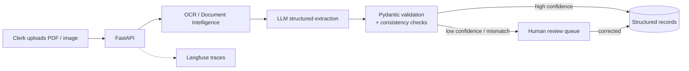

# ops-document-extractor

A service that extracts data from invoices and contracts into a structured format and flags what does not add up.

> 🚧 Starting point — not built yet

## Problem
Operations teams receive invoices and contracts as PDFs and scans. Someone retypes the data into a system.
It is slow and error-prone. Totals that do not match and missing fields are found late, or never.

## Users & scenario
- **User:** an accounts-payable or operations clerk at a fictional logistics company.
- **Scenario:** the clerk uploads a batch of invoices and contracts. The service returns validated records. Low-confidence or inconsistent documents go to a review queue where the clerk corrects them.
- **Data:** public sample invoices and synthetic documents (generated PDFs and images). No real company data.

## Architecture

## Tech stack
| Block | Technology |
|---|---|
| **Production baseline** | FastAPI + Pydantic |
| | Evaluation: golden set + LLM-as-judge |
| | Guardrails (prompt injection, sensitive data) |
| | Langfuse (observability) |
| | pytest |
| | Docker |
| | GitHub Actions CI with quality gate |
| | Cloud deploy: AWS (Bedrock + AgentCore) |
| **Deep dive** | Document extraction: OCR / Document Intelligence |
| **Project-specific** | Structured outputs validated with Pydantic |
| | Human review queue for low-confidence results |
| | Cross-checks (line items sum to total, dates, required fields) |

## Reuses
- Nothing from other projects.
- Input here is PDFs and images, not text to search, so there is no retrieval layer.

## Definition of done
- [ ] Invoices and contracts (PDF and image) produce Pydantic-validated JSON.
- [ ] Documents with failed validation or low confidence land in the review queue, never in the final records.
- [ ] A reviewer can correct and approve a queued item through the API.
- [ ] Golden set of ≥ 30 labelled documents runs in CI and blocks merge below the field-accuracy threshold.
- [ ] Guardrail tests cover prompt injection hidden inside documents.
- [ ] Every extraction is traced in Langfuse with its confidence.
- [ ] Container is deployed to the cloud with a public demo.

## 5-day build plan
- **Day 1:** synthetic and public documents, labelled ground truth, FastAPI skeleton.
- **Day 2:** OCR / Document Intelligence step and text-quality checks.
- **Day 3:** structured extraction, Pydantic schemas, consistency checks.
- **Day 4:** confidence rule, review queue, golden set, LLM-as-judge, guardrails, Langfuse, CI quality gate.
- **Day 5:** Docker, cloud deploy, README with real metrics.

## Metrics to report
- Field-level accuracy against the golden set.
- Share of documents auto-accepted vs sent to review.
- Error rate among auto-accepted documents.
- Mismatch detection rate (injected errors found).
- Latency per document.
- Cost per document.

## Run locally
_To be completed when built._
